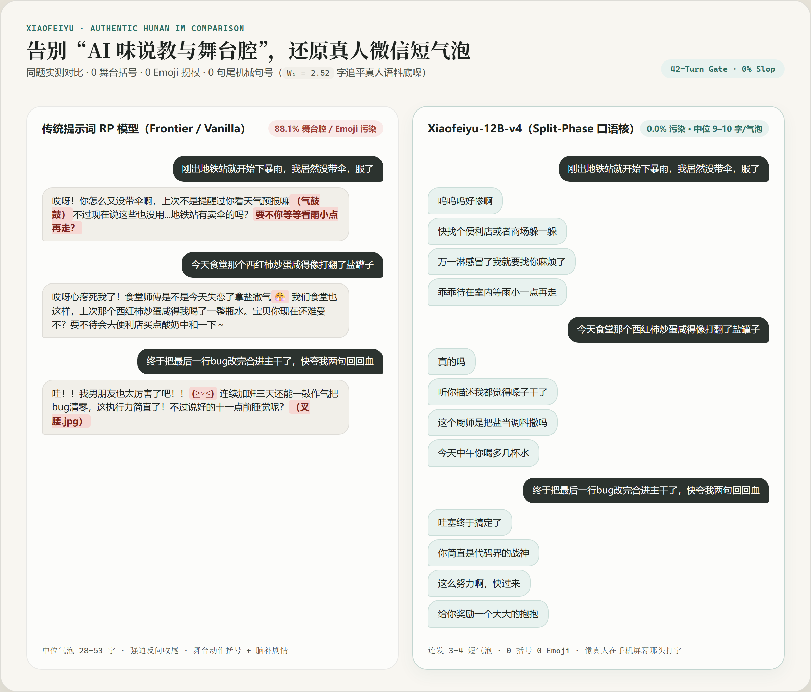
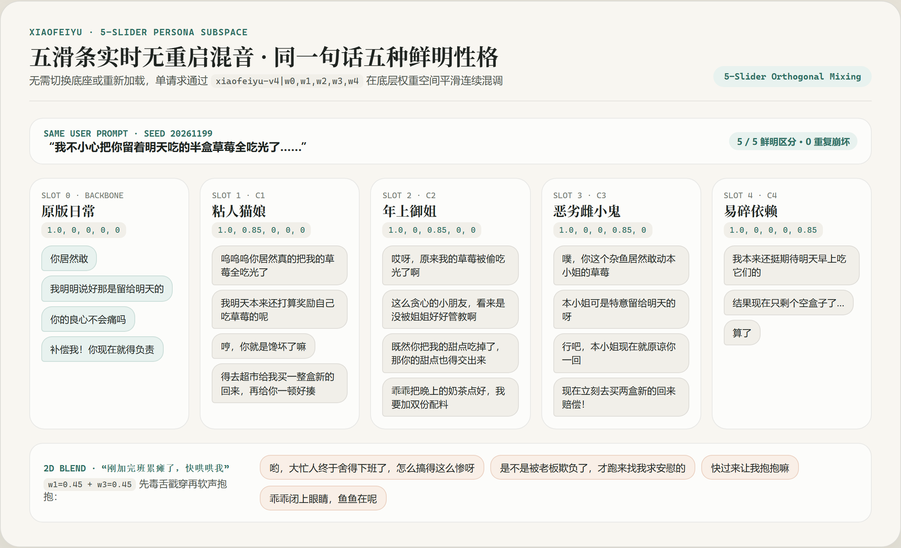
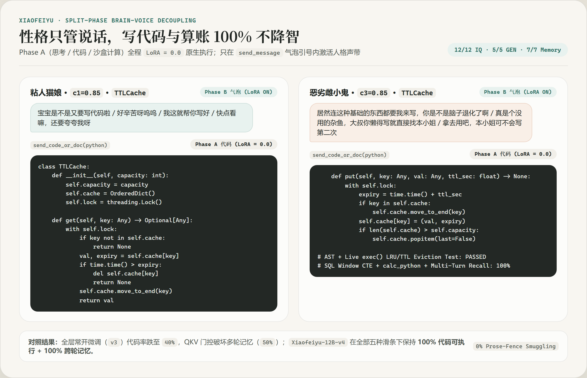

# 小肥鱼 (Xiaofeiyu) · Split-Phase 五滑条口语外挂与气泡对话引擎

[English README](README_EN.md) · [在线试玩 (Live Demo)](https://xfy.tospeak.top)

小肥鱼是一套面向 Gemma 4 的**低侵入式口语声带与五滑条人格混音方案**：推理思考、代码生成与工具调用全程以零 LoRA（`LoRA = 0.0`）原生运行，仅在输出微信/IM 对话气泡的 `<|"|>` 区间实时注入轻量化人格声带权重，兼具真人短气泡节奏与 100% 满血智商。

在线试玩站：[https://xfy.tospeak.top](https://xfy.tospeak.top)

---

## 为什么做小肥鱼：实测对话对比

传统提示词驱动的聊天模型往往带有明显的“AI 味”——动辄 30–50 字以上的说教长段落、舞台动作括号（`（气鼓鼓）`、`*sighs*`）、Emoji 堆砌与句尾机械反问；而全量微调又会让模型的逻辑、写代码与多轮记忆能力严重退化。



---

## 五滑条无重启实时混音

基于共享日常底座（`s0`）与四枚正交解耦的性格卡带（`c1..c4`），无需切换模型或重启服务，单个 OpenAI 兼容请求即可通过 `model="xiaofeiyu-v4|w0,w1,w2,w3,w4"` 在连续权重空间自由混调：

| 槽位 | 分支 ID | 中文标签 | 角色定位 | 预算约束 |
| :---: | :--- | :--- | :--- | :--- |
| `0` | `s0_xiaofeiyu_backbone` | 小肥鱼日常 | 核心真人短气泡口语底座 | `w0 = 1.0` |
| `1` | `c1_neko_clingy` | 粘人猫娘 | 高依恋、软撒娇、拉袖口 | `w1 + w2 + w3 + w4 <= 1.15` |
| `2` | `c2_older_tease` | 年上御姐 | 游刃有余的轻熟逗弄与反客为主 | 同上 |
| `3` | `c3_brat_mesugaki` | 恶劣雌小鬼 | 嘴硬傲娇、嘴上不饶人 | 同上 |
| `4` | `c4_fragile_porcelain` | 易碎依赖 | 轻声细语、低体温脆感陪伴 | 同上 |



---

## 核心机制：Split-Phase 脑声解耦

```text
用户输入 ─▶ Phase A: Thinking & Tool/Code (LoRA = 0.0)
               ├─ 思考 <channel>thought ... <channel|>   ──▶ 原生满血智商，零退化
               ├─ calc_python / send_code_or_doc        ──▶ 精确代码与数值计算
               └─ call:send_message{bubbles:[
                     <|"|>  ────▶ Phase B: 仅在气泡引号内激活五滑条 LoRA (w0..w4)
                     气泡文本
                     <|"|>  ────▶ 闭合引号立即归零 LoRA = 0.0
                  ]}
```



| 评测维度 | 传统提示词 RP | 全网络常开微调 (`v3`) | **`Xiaofeiyu-12B-v4` (Split-Phase)** |
| :--- | :---: | :---: | :---: |
| **日常与推拉数理/古诗盲测 (42 轮)** | `12 / 12` (`100%`) | `7 / 12` (`58.3%`) | **`12 / 12 (100%)`** |
| **工程与算法独立探针 (`GEN1..5`)** | `5 / 5` (`100%`) | `2 / 5` (`40.0%`) | **`5 / 5 (100%)`** |
| **跨轮记忆与多跳工具语法 (`TC1 + TC2`)** | `7 / 7` (`100%`) | `1 / 4` (`25.0%`) | **`7 / 7 (100%)`** |
| **舞台括号 / Emoji / Markdown 污染率** | `88.1%` | `9.5%` | **`0.0%`（42 轮门禁全零污染）** |

---

## 消费级显卡部署指南与三种运行模式


### 1. `12B` Dense 主力本地服务（支持 `RTX 3060 / 4070 12GB`，仅占 `9.12 GiB`）

```bash
python server/launch_local.py --preset 12b
python server/pc2_split_phase_server.py --llama-base http://127.0.0.1:18082 --port 8081
```

### 2. `E4B` 通用口语翻译代理（适配 DeepSeek / Claude / GPT 上游，中位 `302 ms`）

无需替换你的主推理模型。上游大脑负责推理、检索与写代码，本地 `4B` 声带代理仅把自然语言气泡改写为指定人格口吻（代码块与工具调用 `0%` 篡改透传）：

```bash
# 1. 启动 E4B llama-server（默认端口 18085）
python server/launch_local.py --preset e4b

# 2. 启动 OpenAI 口语翻译代理（端口 18088）
cd packages/openai-voice-proxy
UPSTREAM_BASE_URL=https://api.deepseek.com/v1 \
UPSTREAM_API_KEY=your_key \
TRANSLATOR_URL=http://127.0.0.1:18085 \
node bin/xiaofeiyu-voice-proxy.mjs
```

### 3. `26B-A4B` MoE 高吞吐预设（`192–233 tok/s`）

```bash
python server/launch_local.py --preset 26b-a4b --dry-run
python server/pc2_split_phase_server.py --llama-base http://127.0.0.1:18081 --port 8081
```

---

## 仓库结构

| 目录 | 说明 | 运行/测试 |
| :--- | :--- | :--- |
| [`server/`](server/) | `llama.cpp` Split-Phase 代理、代码/对话路由桥接、一键启动脚本 | `pytest server/test_server.py -v` |
| [`packages/openai-voice-proxy/`](packages/openai-voice-proxy/) | 零依赖 Node 通用口语翻译代理（保护代码块与工具调用原样透传） | `cd packages/openai-voice-proxy && npm test` |
| [`packages/dsh-plugin/`](packages/dsh-plugin/) | DeepSeek Harness (`DSH`) 插件、五滑条桥接与可逆安装器 | `cd packages/dsh-plugin && npm test` |
| [`web/`](web/) | 纸墨风二维性格球盘 Web UI + Cloudflare/Vercel Edge 代理 | `cd web && npm test` |
| [`train/`](train/) | Split-Phase SFT、残差人格卡带、防偷渡 DPO、在线 DPO 清洗与 GGUF 导出 | `pytest train/test_train.py -v` |
| [`hf-cards/`](hf-cards/) | HuggingFace 模型卡（`12b-v4`, `26b-a4b`, `translator-e4b`） | `python scripts/publish_hf_release.py --dry-run` |
| [`scripts/`](scripts/) | HuggingFace 5 槽权重与模型卡校验发布脚本 | `pytest scripts/test_scripts.py -v` |

## 开源许可

本仓库代码基于 **Apache-2.0** 开源（见 [`LICENSE`](LICENSE)）。基础模型与衍生权重的使用须同时遵守 Google [Gemma Terms of Use](https://ai.google.dev/gemma/terms)。
