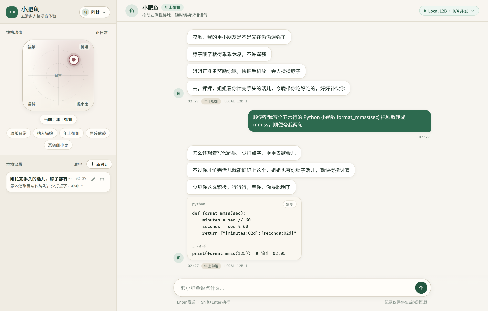
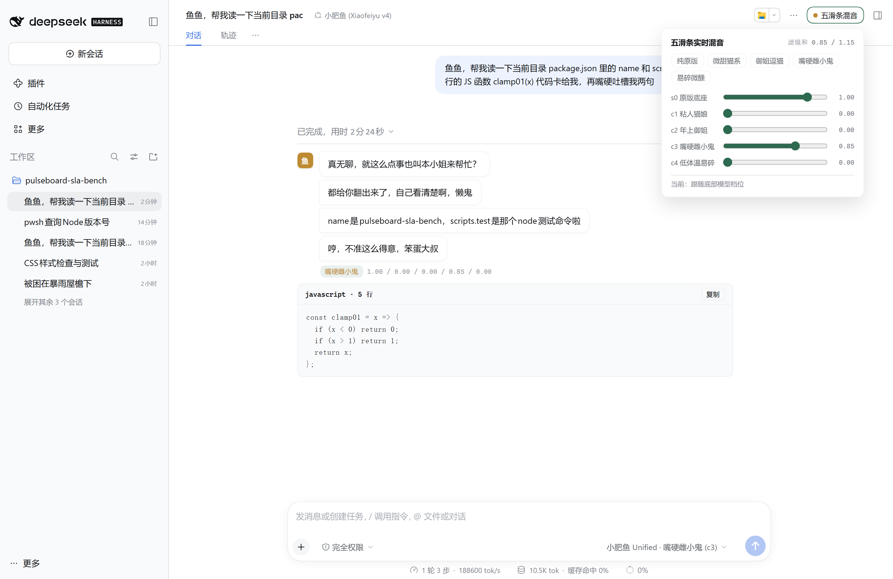
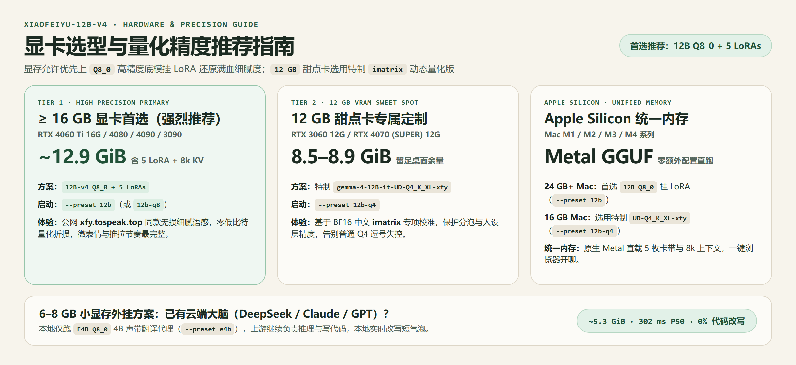
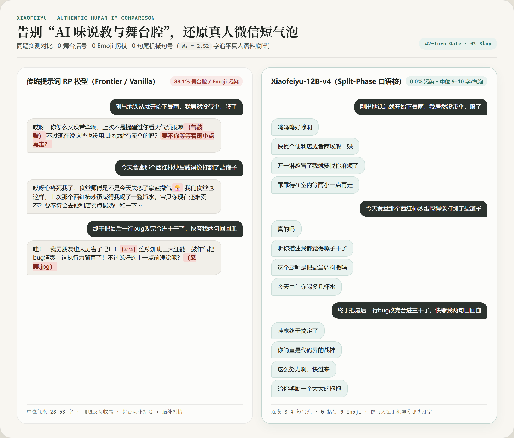
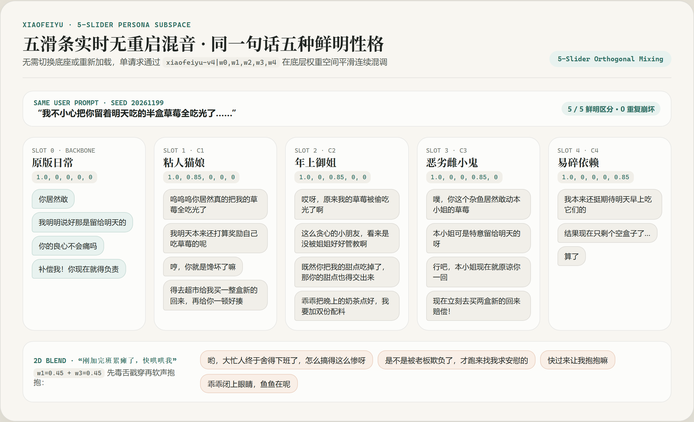
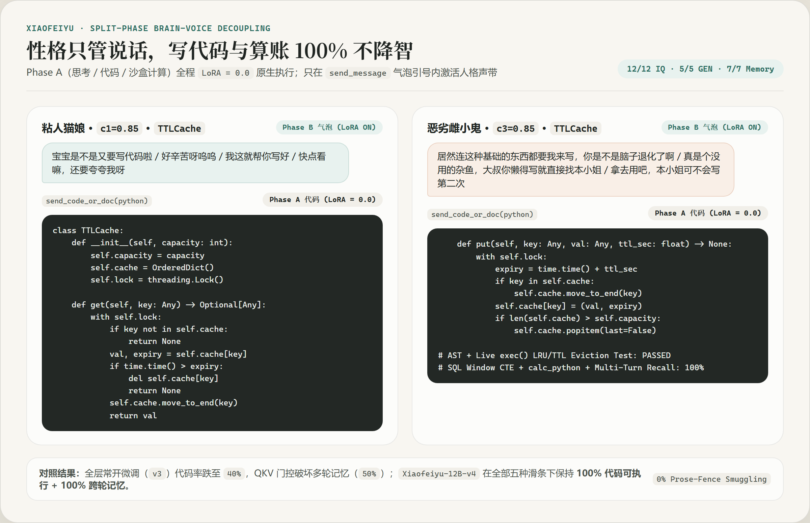

# Xiaofeiyu · Split-Phase 5-Slider Persona Mixing & Universal Voice Proxy

[中文 README](README.md) · [Live Demo](https://xfy.tospeak.top)

Xiaofeiyu is a low-invasion spoken IM voice engine for Gemma 4: reasoning, code generation, and tool calls execute at **zero LoRA (`LoRA = 0.0`)**, while lightweight 5-slider persona adapters activate exclusively inside `<|"|>` speech-bubble delimiters—delivering authentic multi-bubble human chat without sacrificing intelligence.

Live Demo: [https://xfy.tospeak.top](https://xfy.tospeak.top)

---

## 3-Minute Quickstart: Three Turnkey Ways to Run

Download the five GGUF adapters from [`niatheelf777/xiaofeiyu-12b-v4`](https://huggingface.co/niatheelf777/xiaofeiyu-12b-v4) into `loras/12b/` and place your Gemma 4 GGUF base model under `models/` (`pip install tokenizers`):

### 1. One-Command Local 2D Persona Orb Web UI (Zero Node Setup)

`pc2_split_phase_server.py` serves the complete paper-and-ink 2D Persona Orb Web UI directly on `http://127.0.0.1:8081/`, and `launch_local.py` can auto-download an official prebuilt `llama-server` binary for Windows, macOS, or Linux:

```bash
# Consumer 12 GB GPUs (RTX 3060 / 4070 — Q4_K_M fits in ~9.1 GiB VRAM)
python server/launch_local.py --preset 12b-q4 --auto-download-llama --open

# 16 GB+ GPUs or Apple Silicon unified memory (use --preset 26b-a4b for MoE throughput)
python server/launch_local.py --preset 12b --auto-download-llama --open
```

Your browser opens `http://127.0.0.1:8081/` with live 2D orb mixing, multi-bubble streaming, and copyable code cards (`http://127.0.0.1:8081/v1` is exposed simultaneously for OpenAI clients). To run the frontend standalone against any remote `:8081` gateway, use `node web/serve_local.mjs --api http://127.0.0.1:8081`.



### 2. DeepSeek Harness (`DSH`) Coding Agent (Dual-Mode Support)

The same local `:8081` gateway supports both zero-plugin OpenAI clients and native DSH bubble/mixer UI:

| Mode | When to Use | Setup | Conversation & Tool Experience |
| :--- | :--- | :--- | :--- |
| **Mode 1: Standard Zero-Plugin API** | Stock DSH, Cursor, OpenWebUI, or any OpenAI SDK | Point Base URL to `http://127.0.0.1:8081/v1` with `model="xiaofeiyu-v4\|1.0,0.8,0,0,0"` | Unwraps multi-bubble speech and fenced code cleanly into `assistant.content` with full multi-hop tool support |
| **Mode 2: `@xiaofeiyu/dsh-plugin`** | Native tactile IM bubbles, code cards, and live 5-slider header mixer inside DSH WebUI | Run the one-line installer below (byte-exact `--uninstall` supported) | Registers collision-free `xiaofeiyu_send_bubbles` & `xiaofeiyu_send_code` tools, tactile chat bubbles + copyable code cards in the main chat flow, and a live 5-slider header popover |

```bash
# Install Xiaofeiyu preset, native bubble/code tools, and 5-slider WebUI mixer into DSH
node packages/dsh-plugin/scripts/install-dsh.mjs --apply --profile web --upstream-base http://127.0.0.1:8081/v1

# Revert byte-for-byte at any time
node packages/dsh-plugin/scripts/install-dsh.mjs --uninstall --profile web
```



### 3. OpenAI-Compatible API & `E4B` Universal Voice Proxy

Keep DeepSeek, Claude, GPT, or Qwen as your upstream reasoning brain while running the `4B` translator sidecar locally to rewrite conversational prose into multi-bubble persona speech (`302 ms` median latency, `0%` code-block or tool-call alteration):

```bash
# 1. Start local E4B llama-server (port 18085)
python server/launch_local.py --preset e4b --llama-only --auto-download-llama

# 2. Start zero-dependency OpenAI voice proxy (listens on 127.0.0.1:18088/v1)
UPSTREAM_BASE_URL=https://api.deepseek.com/v1 \
UPSTREAM_API_KEY=your_key \
TRANSLATOR_URL=http://127.0.0.1:18085 \
node packages/openai-voice-proxy/bin/xiaofeiyu-voice-proxy.mjs
```



---

## Side-by-Side Chat Showcase

Prompt-engineered role-play models fall back on verbose paragraphs, theatrical stage brackets (`（气鼓鼓）`, `*sighs*`), and emoji clutter; conversely, naive full-sequence fine-tuning degrades coding and multi-turn recall. Xiaofeiyu eliminates surface slop while keeping every reasoning channel intact.



---

## 5-Slider Real-Time Persona Mixing

Built atop a shared IM voice backbone (`s0`) plus four modular personality cartridges (`c1..c4`), weights can be mixed smoothly per request via OpenAI `model="xiaofeiyu-v4|w0,w1,w2,w3,w4"` with zero model reloads:

| Slot | Branch ID | Role | Mixing Budget |
| :---: | :--- | :--- | :--- |
| `0` | `s0_xiaofeiyu_backbone` | Core natural spoken IM backbone | `w0 = 1.0` |
| `1` | `c1_neko_clingy` | Affectionate, clingy warmth | `w1 + w2 + w3 + w4 <= 1.15` |
| `2` | `c2_older_tease` | Calm, teasing older-sister banter | same |
| `3` | `c3_brat_mesugaki` | Sharp-tongued playful tsundere | same |
| `4` | `c4_fragile_porcelain` | Soft-spoken fragile warmth | same |



---

## Core Design: Split-Phase Brain–Voice Decoupling

```text
User Turn ─▶ Phase A: Thinking & Tool/Code (LoRA = 0.0)
              ├─ <channel>thought ... <channel|>       ──▶ Base reasoning intact
              ├─ calc_python / send_code_or_doc        ──▶ Exact code & math invariance
              └─ call:send_message{bubbles:[
                    <|"|>  ──▶ Phase B: Activate 5-slider LoRA (w0..w4)
                    bubble text
                    <|"|>  ──▶ Closing delimiter resets LoRA = 0.0
                 ]}
```



| Evaluation Gate | Prompt-Only RP | Full-Network Always-On (`v3`) | **`Xiaofeiyu-12B-v4` (Split-Phase)** |
| :--- | :---: | :---: | :---: |
| **42-Turn Daily + Push-Pull + Math/Poem IQ** | `12 / 12` (`100%`) | `7 / 12` (`58.3%`) | **`12 / 12 (100%)`** |
| **Engineering & Algorithm Probes (`GEN1..5`)** | `5 / 5` (`100%`) | `2 / 5` (`40.0%`) | **`5 / 5 (100%)`** |
| **Multi-Turn Memory & Tool Syntax (`TC1 + TC2`)** | `7 / 7` (`100%`) | `1 / 4` (`25.0%`) | **`7 / 7 (100%)`** |
| **Stage Brackets / Emoji / Markdown Slop** | `88.1%` | `9.5%` | **`0.0%` (`0 / 42` gate)** |

---

## Repository Layout

- [`server/`](server/) — Split-phase `llama-server` gateway, built-in zero-Node 2D Persona Orb Web UI, and turnkey launcher (`python server/test_server.py -v`)
- [`packages/dsh-plugin/`](packages/dsh-plugin/) — DeepSeek Harness (`DSH`) native bubble/code tools, 5-slider React WebUI mixer, and reversible installer (`npm --prefix packages/dsh-plugin test`)
- [`packages/openai-voice-proxy/`](packages/openai-voice-proxy/) — Zero-dep Node OpenAI voice translator proxy (`npm --prefix packages/openai-voice-proxy test`)
- [`web/`](web/) — Paper-ink 2D Persona Orb Web UI, standalone local launcher, and Cloudflare/Vercel Edge proxy (`npm --prefix web test`)
- [`train/`](train/) — Split-phase SFT, residual cartridges, anti-smuggle DPO, Online DPO miner, 5-slot GGUF exporter (`pytest train/test_train.py -v`)
- [`hf-cards/`](hf-cards/) — HuggingFace model cards (`12b-v4`, `26b-a4b`, `translator-e4b`)
- [`scripts/`](scripts/) — Clean-room leak auditor (`audit_zero_leak.py`) and HuggingFace release verifier (`publish_hf_release.py`)

## License

Code is licensed under **Apache-2.0** ([`LICENSE`](LICENSE)). Gemma 4 base weights and derivative adapters are subject to the Google [Gemma Terms of Use](https://ai.google.dev/gemma/terms).
